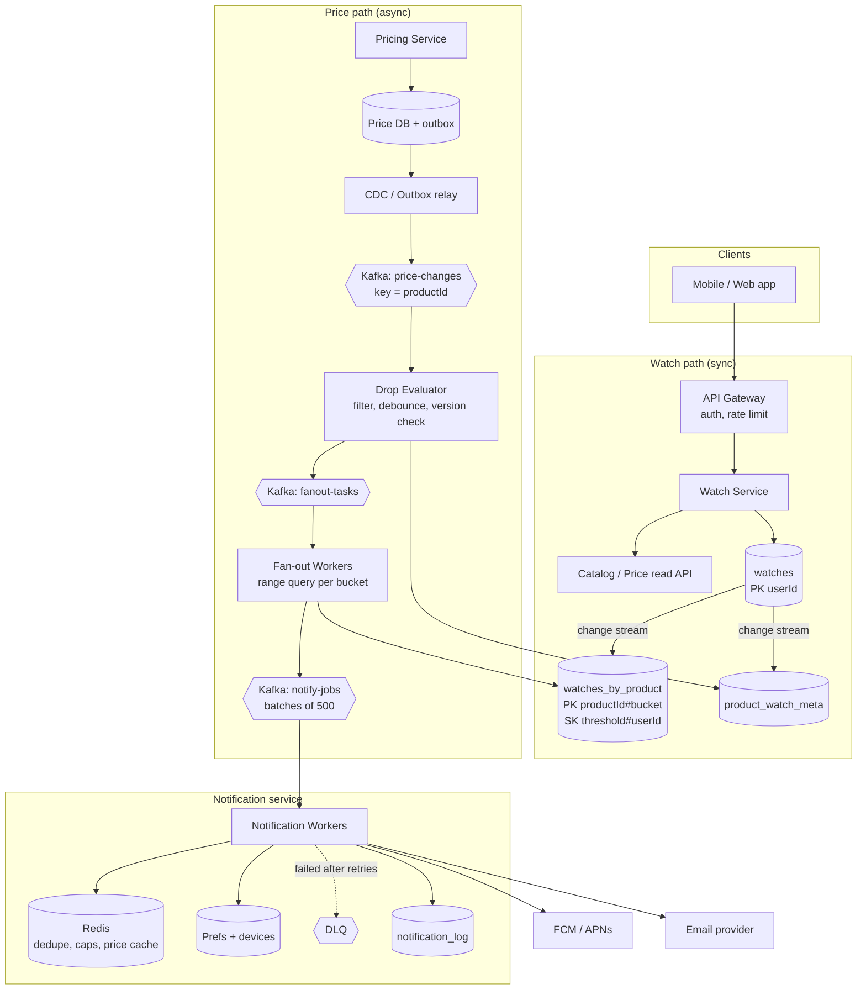
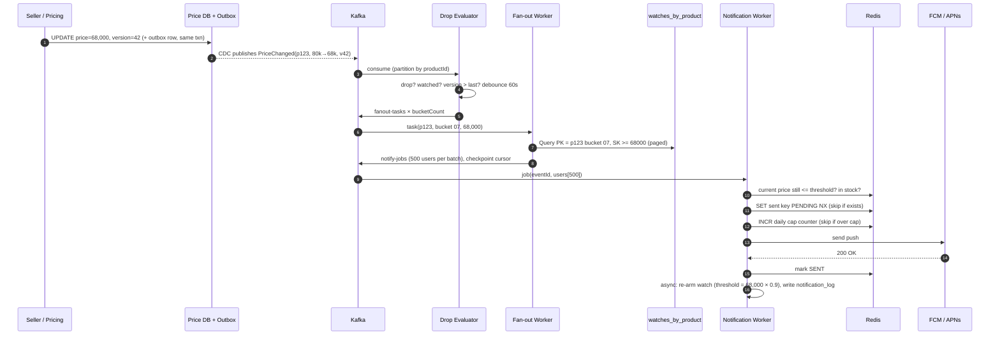

# Price-Drop Alerts for Watched Products

**Type:** HLD case study · **Pattern:** Event-driven fan-out, notification system · **Mock score:** 3/10 (2026-10-24)

> **The prompt (deliberately vague):** "We run a large e-commerce marketplace. Users want to *watch* products and hear when the price drops. Design it."

---

## Table of Contents

- [Quick Revision](#quick-revision)
- [1. Clarifying Questions to Ask](#1-clarifying-questions-to-ask)
- [2. Requirements](#2-requirements)
- [3. Capacity Estimation](#3-capacity-estimation)
- [4. API Design](#4-api-design)
- [5. Data Model](#5-data-model)
- [6. High-Level Architecture](#6-high-level-architecture)
- [7. End-to-End Flows](#7-end-to-end-flows)
- [8. Deep Dive 1: Matching Without Scanning](#8-deep-dive-1-matching-without-scanning)
- [9. Deep Dive 2: Hot Products and Fan-out](#9-deep-dive-2-hot-products-and-fan-out)
- [10. Deep Dive 3: Notification Service, Idempotency and Caps](#10-deep-dive-3-notification-service-idempotency-and-caps)
- [11. Deep Dive 4: Flip-Flopping Prices](#11-deep-dive-4-flip-flopping-prices)
- [12. Reliable Price Events: Outbox and CDC](#12-reliable-price-events-outbox-and-cdc)
- [13. Bottlenecks and Failure Handling](#13-bottlenecks-and-failure-handling)
- [14. Trade-offs and Alternatives](#14-trade-offs-and-alternatives)
- [15. Follow-up Questions with Answers](#15-follow-up-questions-with-answers)
- [16. Concepts Used](#16-concepts-used)
- [17. My Mock vs a Strong Answer](#17-my-mock-vs-a-strong-answer)
- [18. 45-Minute Game Plan](#18-45-minute-game-plan)

---

## Quick Revision

| | |
|---|---|
| **Core idea** | Price change → event on Kafka → find the watches that match → batched notify jobs → idempotent sends |
| **Key trick** | Store `threshold_price` as the **sort key** in a table keyed by product. A drop becomes a **range query** (`threshold >= newPrice`) that returns only the watches that fire, not all of them |
| **Hot product** | Shard the product's watches into buckets (`productId#0..N`) and fan out in parallel |
| **Duplicates** | At-least-once pipeline plus an idempotency key `(userId, productId, priceEventId)` checked before sending |
| **Flip-flop** | Debounce per product (wait for the price to settle), and **re-arm**: the next alert only fires below the last notified price |
| **CAP** | **Availability over consistency.** An alert that's 30s late is fine; the watch API being down during a sale is not |
| **Latency target** | Minutes, not milliseconds: p95 under 5 min; a 5M-watcher fan-out under ~10 min, limited by push-provider quotas |
| **Numbers** | 500M watches (~50GB), ~600 price updates/s average (~10k/s in a sale), hot product = 5M pushes |
| **Reliable events** | Transactional outbox or CDC from the pricing DB. Never "write the DB, then publish" (the dual-write problem) |

---

## 1. Clarifying Questions to Ask

Ask these in the first ~5 minutes. Each answer changes the design.

| Question | Why it matters | Answer used here |
|---|---|---|
| Watch a specific product, or also new launches / categories? | Scope | Specific product only |
| What counts as a "drop"? Any drop, a % drop, or a user's target price? | Defines the matching query | User gets alerted at ≥10% below the price at watch time (target price is an easy extension) |
| Baseline price fixed at watch time, or relative to the previous price? | Relative baseline makes flip-flops re-fire | Fixed at watch time, re-armed after each alert |
| Channels: push, email, SMS, in-app? | Notification service design | Push + email + in-app inbox |
| How fast must the alert arrive? | Drives the whole architecture | Within a few minutes |
| Multiple sellers per product: which price? | Which event triggers us | The "buy box" / lowest available offer |
| Alert if out of stock? | Extra check before sending | No: only alert if purchasable |
| Scale: users, products, watches, price updates per day? | Capacity | 200M MAU, 50M watchers × 10, 100M products, 50M price updates/day |
| Limit on watches per user? | Abuse, storage | 500 per user |

---

## 2. Requirements

### Functional
1. A user can **add** a product to their watchlist, optionally with a custom drop % (default 10%).
2. A user can **view** and **remove** watched products.
3. When a product's price falls to or below the user's threshold, the user gets **one alert** per channel preference.
4. No repeated alerts for the same drop. A new alert only comes after a *further* meaningful drop (re-arm).
5. Users control channels, quiet hours and opt-out.

### Non-functional
| NFR | Target | Reasoning |
|---|---|---|
| Availability | 99.9%+ for the watch APIs and the pipeline | Sales are exactly when the feature matters |
| Consistency | **Eventual** | A few seconds of staleness doesn't hurt; correctness is checked again just before sending |
| Latency | p95 alert < 5 min after the price settles | Push providers and fan-out make "seconds" both pointless and costly |
| Delivery | **At-least-once internally, effectively-once to the user** | No missed alerts, duplicates suppressed |
| Scalability | Horizontal; absorbs a 10–20× sale spike | Queues buffer the burst |
| Durability | No watch is ever lost | It's user data |

> **The trap I fell into:** "users must see the same price" is the **catalog's** consistency requirement, not this system's. Say which system owns which guarantee.

---

## 3. Capacity Estimation

Do this out loud, round aggressively, and finish in about 3 minutes.

**Watches (storage)**
- 50M users × 10 watches = **500M watches**
- One row ≈ 100 bytes (userId, productId, baseline, threshold, timestamps, status)
- 500M × 100B = **50GB** per copy. With two views (by user, by product) that's 100GB, and ×3 replication is ~300GB. **Storage is not the problem.**

**Watch API traffic**
- Adds/removes: around 3M/day → ~**40/s** (peak ~400/s)
- Watchlist views: around 20M/day → ~**250/s** (peak a few thousand/s)
- Tiny. Any database handles this.

**Price changes (the real input)**
- 50M/day ÷ 86,400 ≈ **~600/s average**
- Sale spike 10–20× → **~10k/s**
- Only **drops** on **watched** products matter. That's maybe half or less of these.

**Notifications (the real output)**
- Normal day: if ~1% of watches fire → 5M alerts/day ≈ 60/s. Easy.
- Sale: a hot phone with **5M watchers** drops 15% → **5M alerts at once**. This burst is what we design for.

**How long does the burst take?** (I guessed instead of dividing. Divide.)
- One sender worker ≈ 1,000 pushes/s (HTTP/2, batching)
- 5M ÷ 1,000 = **5,000 worker-seconds**
  - 50 workers → 100s
  - 1,000 workers → 5s (wasteful: idle the rest of the year)
- **Push providers rate-limit per project** (FCM's default is on the order of hundreds of thousands of messages per minute; check the current quota). At ~600k/min, 5M takes **~8–9 min** whatever you do.
- ⇒ The honest SLA is **minutes**. Spread the burst evenly, and prioritize users with recent activity.

**Dedupe and cap state (Redis)**
- 5M keys/day × ~60B = ~300MB. Trivial.

---

## 4. API Design

The userId always comes from the **auth token**, never from the path or body. The **server** reads the baseline price, never the client.

```http
PUT /v1/me/watches/{productId}          # idempotent "add" — PUT, not POST, so retries are safe
Body: { "dropPercent": 10 }             # optional; default 10
201 → { "productId": "p123", "baselinePrice": 8000000, "thresholdPrice": 7200000,
        "currency": "INR", "createdAt": "2026-10-24T08:00:00Z" }
# Prices in minor units (paise) as integers — never floats.

GET /v1/me/watches?limit=20&cursor=abc  # paginated watchlist (cursor, not offset)
200 → { "items": [ { "productId", "title", "image", "baselinePrice",
                     "currentPrice", "thresholdPrice", "lastNotifiedAt" } ],
        "nextCursor": "def" }

DELETE /v1/me/watches/{productId}       # 204, idempotent

PUT /v1/me/notification-settings        # channels, quiet hours, opt-out
POST /v1/me/devices                     # register push token { token, platform }
```

**Internal interfaces are events, not REST calls that carry user lists.**
- `price-changes` topic: `{ productId, offerId, oldPrice, newPrice, version, eventId, ts }`
- `fanout-tasks` topic: `{ productId, bucket, newPrice, eventId }`
- `notify-jobs` topic: `{ eventId, productId, newPrice, userIds: [≤500] }` (batched, so no message ever carries 5M IDs)

Why my original APIs were weak:
- `GET` for a write → not safe or cacheable semantics; crawlers or prefetch could trigger it.
- The client sending `price` → anyone can set `price=9999999` and get alerted on everything.
- `GET /users/product/{id}` returning 5M users → no pagination, huge response, and the wrong abstraction (it should be a stream of tasks).

---

## 5. Data Model

### Choice: DynamoDB / Cassandra (wide-column, key-value)
- Access is purely by key: "watches of user X" and "watches of product Y with threshold ≥ P". There are **no joins**.
- It scales writes horizontally, and the sort keys give us range queries.
- (Postgres with an index on `(product_id, threshold_price)` also works at 500M rows if sharded by product. Say this to show you know the alternative.)

### Tables

**1. `watches` — the source of truth, by user**
| Field | Notes |
|---|---|
| **PK** `userId` | |
| **SK** `productId` | the watchlist page is one partition read |
| `baselinePrice` | server-read at watch time (minor units) |
| `dropPercent` | default 10 |
| `thresholdPrice` | = baseline × (1 − drop%); **recomputed on re-arm** |
| `lastNotifiedPrice`, `lastNotifiedAt` | for re-arm and display |
| `bucket` | = hash(userId) % bucketCount(product) |
| `status` | ACTIVE / PAUSED |
| `createdAt` | |

**2. `watches_by_product` — the matching index** (a GSI on computed attributes, or a second table kept in sync by a change stream)
| Field | Notes |
|---|---|
| **PK** `productId#bucket` | e.g. `p123#07` — spreads a hot product over many partitions |
| **SK** `thresholdPrice#userId` | zero-padded price so it sorts as a number; userId makes it unique |

Query on a drop to price **P**: `PK = p123#07 AND SK >= "P"` → only the watches whose threshold ≥ P, i.e. the ones that should fire.

**3. `product_watch_meta`**
| `productId` (PK) | `watchCount` | `bucketCount` | `lastProcessedVersion` |

Used to skip unwatched products, to know how many buckets to fan out to, and to drop stale or out-of-order events.

**4. `fanout_progress`** (checkpoint) — `eventId#bucket` → `lastEvaluatedKey`, `status`. Lets a crashed worker resume.

**5. `notification_log`** (Cassandra) — PK `userId`, SK `ts DESC`. Powers the in-app inbox and analytics.

**6. Redis**
- `price:{productId}` → `{price, version, inStock}` (hot cache for the check just before sending)
- `sent:{userId}:{productId}:{eventId}` → `PENDING|SENT`, TTL 7d (idempotency)
- `cap:{userId}:{yyyymmdd}` → counter, TTL 48h (daily cap)
- `debounce:{productId}` → latest pending price + deadline

**7. `devices`** — PK `userId`, SK `deviceToken`; platform, lastSeen.

---

## 6. High-Level Architecture



**Why each box exists**
- **Watch Service**: a thin CRUD layer. It reads the current price from Catalog so the client can't fake the baseline.
- **CDC / Outbox**: guarantees every committed price change becomes an event (see §12).
- **Kafka keyed by productId**: keeps events for one product in order and buffers sale spikes.
- **Drop Evaluator**: cheap filtering. It drops ~90% of events (price increases, unwatched products, stale versions) and debounces.
- **Fan-out Workers**: turn one event into N user batches using the range query. They checkpoint so a crash resumes.
- **Notification Service**: owns dedupe, caps, preferences, provider rate limits, retries and DLQ. It's reusable by other teams.

---

## 7. End-to-End Flows

### 7a. Add a watch
1. `PUT /v1/me/watches/p123` → Gateway authenticates and gets userId.
2. Watch Service checks the per-user limit (≤500) and reads the **current price** from Catalog: 80,000.
3. Computes threshold = 72,000 and bucket = hash(userId) % bucketCount(p123).
4. Writes `watches` (conditional put, so it's idempotent).
5. The change stream updates `watches_by_product` and increments `watchCount`. If the count crosses a bucket boundary, `bucketCount` grows (only ever up).

### 7b. Price drops → phone buzzes



---

## 8. Deep Dive 1: Matching Without Scanning

**Naive:** on each drop, read all 5M watches of the product and compare in code. That's 5M reads per event, 50M events/day. ❌

**Better:** precompute `thresholdPrice` at write time and make it the **sort key**:

```
PK = p123#07     SK = 0005800000#u_88   ← threshold 58,000
                 SK = 0006400000#u_12   ← threshold 64,000
                 SK = 0007200000#u_45   ← threshold 72,000   ✅ fires at 68,000
                 SK = 0007650000#u_03   ← threshold 76,500   ✅ fires at 68,000
```

New price 68,000 → `SK >= "0006800000"` → returns **only** u_45 and u_03.

- Read cost is proportional to **watches that fire**, not to watches that exist.
- A 1% drop on a 5M-watcher product with 10% thresholds returns ~0 rows. It's cheap to ignore.
- Re-arm moves the row to a lower SK, so already-alerted users don't match again.

**Alternative:** a Redis sorted set per product (`ZADD p123 72000 u_45`, then `ZRANGEBYSCORE p123 68000 +inf`). It's fast, but 500M members in memory is ~50–100GB of RAM. It's fine as a cache for hot products; keep the source of truth in the database.

---

## 9. Deep Dive 2: Hot Products and Fan-out

**Problem:** one product with 5M watchers is a **hot partition**. A single DynamoDB partition gives about 3,000 RCU, and one consumer reading it serially is slow.

**Solution: buckets + parallel fan-out**
- `bucketCount = ceil(watchCount / 50,000)`, so 5M watchers → 100 buckets.
- Bucket = `hash(userId) % bucketCount`. Store the bucket on the watch row.
- `bucketCount` **only grows**. If it changed while watches were being written, the Evaluator fans out to buckets `0..max` and every row is still found.
- The Evaluator emits **one fan-out task per bucket** → 100 workers query in parallel.
- Each worker pages through results (e.g. 1,000 per page), publishes notify-jobs of 500 users, and **checkpoints** `lastEvaluatedKey` in `fanout_progress`. After a crash it resumes from the checkpoint, and dedupe absorbs anything replayed.

**Protecting everyone else**
- A **separate Kafka topic / consumer group for hot fan-outs**, so one iPhone drop doesn't delay every other alert.
- **Rate limit the drain** to the push-provider quota. Kafka holds the backlog, which is fine.
- **Priority**: users active in the last 7 days first.
- **Pre-scale** before known sale events.

---

## 10. Deep Dive 3: Notification Service, Idempotency and Caps

### Why duplicates happen
Kafka is **at-least-once**. A worker can send the push and then crash before committing its offset. The job is redelivered, and the user gets the alert twice.

### Idempotency key
`sent:{userId}:{productId}:{eventId}`. The same price event never notifies the same user twice.

```text
1. SET key "PENDING" NX EX 300      → fails? someone else has it / already sent → skip
2. send to provider
3. SET key "SENT" EX 7d             → durable marker
crash between 1 and 3 → PENDING expires after 5 min → retry sends (rare duplicate, never a loss)
```

- **Mark before send, permanently** = at-most-once (can lose alerts). ❌
- **Mark after send only** = at-least-once (duplicates on crash).
- **PENDING lease + SENT** = at-least-once with a tiny duplicate window. ✅ Good enough. **True exactly-once to a phone is impossible**: the provider call isn't transactional with your DB. Say this explicitly.

### Daily cap and preferences
- `INCR cap:{userId}:{date}`. If it's over N (e.g. 3 alerts/day), suppress the alert or roll it into a **daily digest**.
- Quiet hours in the user's time zone → schedule for later (a delay queue).
- Opt-out / channel preferences come from a prefs cache.

### Final check before sending
Re-read `price:{productId}` from Redis. If the price went back up, or it's out of stock → **don't send**. This makes eventual consistency upstream safe.

### Delivery
- Channel adapters: FCM (Android/web), APNs (iOS), email, plus the in-app inbox (`notification_log`).
- A **token bucket per provider** to stay under the quota.
- Retries with **exponential backoff + jitter** on 5xx/429. Unregistered tokens → delete the device.
- After N retries → **DLQ** with alerting, and a replay tool.
- **Separate queues by priority**: OTP/order updates must never wait behind a 5M price-alert burst.

---

## 11. Deep Dive 4: Flip-Flopping Prices

The seller goes 80k → 72k → 80k → 72k within an hour.

| Technique | What it does |
|---|---|
| **Debounce per product** | Hold the latest price for ~60s (max 5 min). Only the settled price is evaluated. Kills rapid repricing bot noise |
| **Re-arm** | After alerting at 72k, set the threshold to 72k × 0.9 = 64.8k. Going back to 80k and down to 72k again → **no alert** |
| **Idempotency per eventId** | Same event replayed → no duplicate |
| **Daily cap** | Safety net across all products |
| **Final price check** | If the price bounced back before the send → skip |

Re-arm is the cleanest fix, and it falls straight out of the sort-key design.

---

## 12. Reliable Price Events: Outbox and CDC

**The dual-write problem:** the Pricing Service does `UPDATE price` and then `kafka.publish()`. If it crashes in between → the price changed but no event was published → missed alerts. If it publishes first and the DB write fails → a phantom event.

**Fixes**
- **Transactional outbox**: in the same DB transaction, insert a row into an `outbox` table. A relay process reads the outbox and publishes to Kafka (at-least-once).
- **CDC (Change Data Capture)**: Debezium tails the DB's write-ahead log or binlog and publishes every committed change.

**Ordering:** partition by `productId` → per-product order. Still carry a `version` and drop any event with `version <= lastProcessedVersion` (protects against replays and reorders).

---

## 13. Bottlenecks and Failure Handling

| Failure / bottleneck | Impact | Mitigation |
|---|---|---|
| Sale spike, 10k+ price events/s | Evaluator lag | Kafka buffers; autoscale consumers on lag; Evaluator drops most events cheaply |
| Hot product (5M watchers) | Hot partition, slow fan-out | Buckets + parallel fan-out + separate topic |
| Push provider throttling (429) | Backlog | Token bucket, backoff, accept minutes of drain, prioritize active users |
| Push provider outage | Alerts stuck | Retry, fall back to email/in-app, DLQ + replay |
| Fan-out worker crash mid-way | Partial send | Checkpointed cursor + idempotency keys |
| Notification worker crash after send | Duplicate | PENDING/SENT idempotency key |
| Redis down | No dedupe/caps | Redis cluster with replicas; on failure, **pause sending** (prefer late over spammy) |
| Index (GSI) lag | A brand-new watch misses an alert seconds after creation | Acceptable under eventual consistency |
| Price DB → Kafka gap | Missed events | Outbox/CDC; a periodic reconciliation job compares prices against the last processed version |
| Out-of-order events | Alert on an old price | Version check + final price check |
| Poison message | Consumer stuck | Retry count → DLQ |
| Region outage | Feature down | Multi-AZ by default; multi-region active-passive for watches; alerts can lag |

**Monitoring:** consumer lag per topic, time from price change to send (p50/p95), send success rate per provider, duplicate rate (sampled), DLQ depth, CTR of alerts.

---

## 14. Trade-offs and Alternatives

| Decision | Chosen | Alternative | Why |
|---|---|---|---|
| Push vs pull | **Push on price change** (event-driven) | Cron scans all watches every N min | The cron re-reads 500M rows over and over; events do work only on change |
| Matching | **Sort key on threshold** | Scan + filter in code | Reads only the rows that fire |
| DB | **DynamoDB / Cassandra** | Sharded Postgres | Key-only access, easy horizontal scale; Postgres is fine too if sharded by product |
| CAP | **AP / eventual** | CP | Late is fine, down is not; final check catches staleness |
| Delivery | **At-least-once + idempotency** | Exactly-once | Exactly-once to devices is impossible |
| Repeat alerts | **Re-arm + cap** | Relative baseline | A relative baseline re-fires on flip-flops |
| Debounce | **60s window** | None | Adds a minute of latency, removes most of the noise |
| Synchronous call from Pricing | **No, events** | Pricing calls the alert service directly | Couples the seller's write latency to a 5M fan-out |

---

## 15. Follow-up Questions with Answers

**Q1. Why not a cron job that checks all watches every 10 minutes?**
It reads 500M rows every run even when nothing changed. That's 72 full scans a day, and latency is bounded by the interval. Event-driven does work proportional to changes. A cron is fine only as a **reconciliation** safety net (e.g. daily).

**Q2. What if the user wants a target price instead of a %?**
The same design works: `thresholdPrice = targetPrice`. The sort key doesn't care how the threshold was computed.

**Q3. A product has many sellers. Which price triggers the alert?**
Only events where the **buy-box / lowest in-stock offer** changes. The Evaluator computes min(offer prices) per product and emits only when that minimum changes.

**Q4. What if the price drops but the product is out of stock?**
Check `inStock` in the final check before sending. Optionally keep the watch armed and alert on "back in stock at the lower price".

**Q5. How do you guarantee no duplicates?**
You can't guarantee it end to end. You can make it rare: idempotency key per (user, product, event), PENDING lease, version checks, re-arm. State the trade-off: we prefer a rare duplicate over a lost alert.

**Q6. How would you handle 10× traffic on sale day?**
Kafka absorbs the burst. Autoscale on consumer lag. Pre-warm capacity (DynamoDB provisioned or on-demand, workers, provider quota increase). Put hot products on a separate topic. Turn on digest mode if the backlog exceeds X.

**Q7. A user removes the watch while fan-out is in progress.**
The fan-out may already have queued them. The notification worker can re-check the watch's status (cheap point read) before sending. Or accept one stray alert; state which.

**Q8. Events arrive out of order (72k after 68k).**
Per-product Kafka partitioning keeps order within a partition. The `version` check drops stale events. The final check reads the current price.

**Q9. How do you avoid hurting OTP and order notifications?**
Separate topics and worker pools by priority. Separate provider quotas or projects if possible. Price alerts are **low priority** and must yield.

**Q10. Why PUT instead of POST to add a watch?**
PUT on `/me/watches/{productId}` is naturally idempotent: retries, or a double tap, produce one watch. POST would need an idempotency key header.

**Q11. How do you shard the watches table?**
By `userId` for the user view, and by `productId#bucket` for the matching view. Two access patterns → two keys, kept in sync by a change stream or a GSI.

**Q12. What's the read amplification on a 1% price drop for a 5M-watcher product?**
Nearly zero: the range query `SK >= newPrice` returns only thresholds above the new price. With 10% thresholds, nothing matches.

**Q13. How do you handle quiet hours and time zones?**
Store the user's time zone in prefs. If an alert lands in quiet hours, put it on a **delay queue** (or a scheduled job table) for the next allowed window, and re-check the price at send time.

**Q14. How do you stop abuse (a user watching 1M products)?**
Per-user limit (e.g. 500), API rate limiting, and bot detection at the gateway.

**Q15. How would you go multi-region?**
Watches are user data → replicate (DynamoDB Global Tables / Cassandra multi-DC). Run the price pipeline in the pricing system's home region. Notification workers can run anywhere. Dedupe keys must be global, or the pipeline single-homed, to avoid double sends across regions.

**Q16. How do you know it works? What do you measure?**
Time from price change to delivery (p50/p95), alerts sent vs eligible, duplicate rate (sampled client-side), DLQ depth, CTR → purchases (business value), unsubscribe rate (spam signal).

**Q17. How do you roll it out safely?**
Feature flag. **Shadow mode**: run matching, log who *would* be notified, compare with an offline scan. Ramp by % of users. Kill switch on the notification service.

**Q18. What if Redis loses the dedupe keys?**
Duplicates possible for replays in that window. Mitigate with Redis replication + AOF. For stricter needs, use a DynamoDB conditional write as the idempotency store (slower, durable).

**Q19. Why not let the Pricing Service call the notification service directly?**
It couples the seller's update latency and availability to a fan-out that can take minutes, and that fan-out fails independently. Events decouple and buffer.

**Q20. How many Kafka partitions?**
Size for peak throughput per consumer. If a consumer handles ~500 events/s and the peak is 10k/s → ≥20 partitions; pick 64–128 for headroom (partitions can't easily shrink). Key = productId.

**Q21. How would you build the digest ("3 items in your watchlist dropped")?**
Instead of sending immediately, append to `pending_digest:{userId}`. A scheduled job per time zone builds and sends one email per day. It's the same dedupe and cap logic.

**Q22. Do we store notification history?**
Yes, in `notification_log` (Cassandra, PK userId, TTL 90 days). It powers the in-app inbox and analytics, and it's a fallback dedupe source.

---

## 16. Concepts Used

| Concept | One-line meaning | Where it shows up |
|---|---|---|
| **Fan-out (on write vs on read)** | Turning one event into many deliveries; here we fan out on the price event | §9 |
| **Event-driven architecture** | Services react to events on a log instead of calling each other | §6 |
| **Kafka partition key** | Same key → same partition → ordered | price-changes keyed by productId |
| **At-least-once / at-most-once / exactly-once** | Delivery guarantees; exactly-once end to end is a myth across external systems | §10 |
| **Idempotency key** | A unique ID that makes repeating an operation harmless | sent:{u}:{p}:{event} |
| **Transactional outbox** | Write the event row in the same DB txn, publish later | §12 |
| **CDC** | Stream the DB's change log as events (Debezium) | §12 |
| **Dual-write problem** | DB + queue writes can't be atomic without an outbox/CDC | §12 |
| **Hot partition / hot key** | One key gets disproportionate traffic | iPhone with 5M watchers |
| **Bucketing / key salting** | Append `#n` to a hot key to spread it | productId#bucket |
| **GSI** | DynamoDB secondary index with a different PK/SK; eventually consistent | watches_by_product |
| **Sort-key range query** | Partition + ordered SK enables `>=` queries | threshold matching |
| **Debouncing / coalescing** | Wait for changes to settle; keep only the latest | §11 |
| **Backpressure** | Slow the producer or buffer when the consumer can't keep up | provider quotas |
| **Token bucket rate limiter** | Allow N ops/sec with bursts | per-provider send rate |
| **DLQ** | Queue for messages that keep failing, for inspection/replay | §10 |
| **Exponential backoff + jitter** | Retry after 1s, 2s, 4s… with randomness so clients don't retry in sync | provider retries |
| **CAP / PACELC** | Under partition choose C or A; otherwise latency vs consistency | §2 |
| **Eventual consistency** | Replicas converge; reads may be briefly stale | GSI, cache |
| **Cursor pagination** | Page with an opaque "last key" instead of an offset | GET watches, fan-out |
| **Money as integers** | Store minor units (paise) to avoid float rounding | prices |
| **Shadow mode / feature flag** | Run new logic without user impact; toggle at runtime | rollout |

---

## 17. My Mock vs a Strong Answer

| Area | What I did | What a strong answer does |
|---|---|---|
| Clarifying | Asked scope and scale ✅, settled on a fixed baseline when pushed ✅ | Also asks about channels, latency, multiple sellers, stock, limits per user |
| NFRs | Picked consistency over availability; latency "x" then milliseconds | AP + eventual; p95 in minutes, with a reason |
| Capacity | Not computed; guessed 1s, then 5s | 500M watches/50GB, 600/s average and 10k/s peak price events, 5M burst ÷ throughput = minutes |
| API | GET for a write, client-sent price, 5M-user payloads | PUT idempotent, server-read baseline, cursor pagination, events internally |
| Data model | Single WatchList table, no keys | Two access patterns → two keys; threshold as SK; buckets |
| Architecture | Verbal: "compare and push to queue" at minute 45 | Diagram by minute 20: outbox → Kafka → evaluator → fan-out → notify |
| Reliability | Skipped duplicates and missed alerts three times | Idempotency key, checkpoints, DLQ, final check |
| Flip-flop | Daily cap ✅ | Debounce + re-arm + cap |

**Top 3 to drill:** (1) do the arithmetic for capacity; (2) say "what happens on crash and retry" for every component; (3) design keys from the access patterns.

---

## 18. 45-Minute Game Plan

| Min | Do |
|---|---|
| 0–5 | Clarify scope, the definition of "drop", channels, latency, scale. Write the functional list |
| 5–8 | NFRs with numbers and a CAP choice **with a reason** |
| 8–12 | Capacity: storage, input QPS, output burst, the burst ÷ throughput sum |
| 12–16 | APIs (3–5 endpoints) + internal events |
| 16–20 | Data model from the access patterns |
| 20–28 | Draw the architecture, walk both flows |
| 28–40 | Deep dive: matching sort key + hot fan-out + idempotency |
| 40–45 | Failures, monitoring, trade-offs |
